<!--
  Katiso Ntseare | GitHub Profile
  Keep this profile focused on engineering, featured work and professional growth.
-->

  

  

  
  
  

  
  
  
  
  
  

 

---

## About me

I'm a **Software Developer and Systems Builder** based in South Africa. I turn ideas and real-world requirements into practical software, with interests spanning backend and frontend engineering, API design, relational databases, software architecture, application security and cloud deployment.

I care about more than getting an application to work. I focus on understanding the problem, making sound engineering decisions and building systems that are secure, maintainable and ready to evolve. My foundation in Information Technology and Software Development at **Nelson Mandela University** continues to shape the way I approach engineering challenges.

## Languages and frameworks

  <strong>Programming languages</strong>
    
  

  <strong>Frameworks and libraries</strong>
    
  

  <strong>Databases, developer tools and platforms</strong>
    
  
    
  
  
  

## Engineering focus

<h3>
  
  Backend and API engineering
</h3>

Designing APIs, implementing business logic, authentication, authorisation, integrations and maintainable service layers.

<h3>
  
  Frontend engineering
</h3>

Building responsive interfaces, reusable components, form workflows, state management and reliable frontend-to-API integration.

<h3>
  
  Database engineering
</h3>

Working with relational data models, SQL queries, constraints, migrations, data access and persistence.

<h3>
  
  Software architecture
</h3>

Applying modular design, separation of concerns, clear application boundaries and maintainable engineering practices.

<h3>
  
  Application security and quality
</h3>

Practising secure development, validating inputs, testing application behaviour and assessing potential vulnerabilities.

<h3>
  
  Cloud, infrastructure and delivery
</h3>

Working with hosting, IIS deployments, cloud infrastructure, DNS, environment configuration and development workflows.

---

## Featured work

### Luminar Learning

  

**Illuminate your mind, Elevate your future.**

Luminar Learning is a collaborative digital tutoring marketplace developed at Nelson Mandela University. The platform is designed to connect learners with independent tutors and academies through a structured online learning environment.

**What the platform brings together**

- **Multi-role learning environment:** Students, independent tutors, academy administrators, academy HR, academy tutors and platform administrators.
- **Learning modules:** Tutors and academies can publish learning modules for students.
- **Lesson verification:** OTP-based lesson completion helps verify that lessons have taken place.
- **Payments and tutor earnings:** PayFast payment integration, platform commission handling, wallet balances and withdrawal workflows.
- **Administration and reporting:** Verification workflows, role-scoped reporting and operational oversight.

**Technology and architecture**

  
    
  
  
  
  
  

The system uses a Next.js and TypeScript frontend, an ASP.NET Core Web API, Entity Framework Core, ASP.NET Identity and SQL Server. Integrations include Cloudinary for media, PayFast for payments, SMTP notifications and a Python document service for generated reports.

  

Collaborative software project. The live application is hosted on the Nelson Mandela University IIS environment. The source repository is private.

### ProSubnet

A terminal-inspired IPv4 subnetting assistant built with **React 18** and **Tailwind CSS**.

- Performs standard IPv4 subnetting and Variable Length Subnet Masking (VLSM).
- Calculates network addresses, usable IP ranges, broadcast addresses and subnet masks.
- Includes command history, help commands and keyboard navigation.

  
  

## GitHub portfolio

  
  
  

Repository counts reflect the repositories owned by this account when checked on 4 November 2026. Private work is not included in public profile statistics.

## GitHub statistics

  
  

  

## Contribution activity

  <picture>
    <source media="(prefers-color-scheme: dark)" srcset="./profile/contribution-snake-dark.svg" />
    <source media="(prefers-color-scheme: light)" srcset="./profile/contribution-snake.svg" />
    
  </picture>

  Statistics and activity visuals are generated by external services and may be delayed or temporarily unavailable. Language statistics generally reflect repositories visible to those services; private work may not be represented.

---

  <strong>Thanks for visiting my profile.</strong>
   
  Building with purpose. Learning continuously. Improving with every project.

